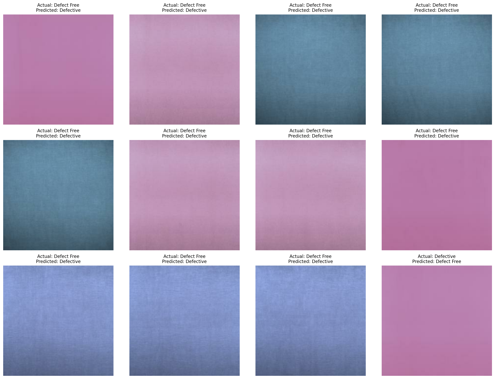

# Automated Fabric Defect Detection

## Project Overview
This project develops and benchmarks an automated fabric defect classification pipeline using two approaches:

1. Roboflow no-code model (ResNet18)
2. Custom Python-based transfer learning model (MobileNetV2)

The objective is to classify fabric images as defective or defect-free, compare model performance, and investigate misclassified images.

## Dataset
The dataset was prepared using Roboflow and exported for custom model training.

The original dataset included three categories:
- Defected
- Defect free
- Waste

For binary classification, Defected and Waste were combined into the defective category.

Final classes:
- defective
- defect_free

The dataset was separated into training, validation, and testing sets.

## Model 1: Roboflow ResNet18
The first model was trained using Roboflow's no-code classification workflow.

Reported test-set results:
- Precision: 96.1%
- Recall: 89.8%
- F1 Score: 92.5%
- Cloud API inference latency: 2.3 ms

## Model 2: MobileNetV2
The second model was developed using TensorFlow/Keras with a pretrained MobileNetV2 backbone.

Configuration:
- Input image size: 160 × 160 pixels
- Batch size: 32
- Epochs: 3
- Optimizer: Adam
- Learning rate: 0.001
- Loss function: Binary Crossentropy

The model was trained using transfer learning.

## Performance Comparison

| Metric | Roboflow ResNet18 | MobileNetV2 |
|---|---|---|
| Accuracy | Not reported | 95.77% |
| Precision | 96.1% | 96.0% |
| Recall | 89.8% | 96.0% |
| F1 Score | 92.5% | 96.0% |
| Training Time | Not reported | 12.27 minutes |
| Inference Latency | 2.3 ms | 41.23 ms |

Note: Roboflow latency represents cloud API inference, while MobileNetV2 latency was measured in Google Colab. These measurements use different environments and are not directly equivalent.

## Failure Analysis
The MobileNetV2 model was evaluated on 497 test images.

The confusion matrix was:

| Actual / Predicted | Defect Free | Defective |
|---|---:|---:|
| Defect Free | 36 | 11 |
| Defective | 10 | 440 |

The model correctly classified 476 out of 497 images.

Some defect-free fabric images were incorrectly classified as defective, while some defective images were classified as defect-free.

Possible causes include subtle fabric textures, low-contrast defects, visual similarity between classes, and class imbalance.

## Repository Files

- fabric_defect_detection_safe.ipynb — Google Colab notebook for model development and evaluation.
- infer.py — Python inference script.
- predictions.csv — Predictions generated for 50 images using Roboflow.
- benchmark_comparison.csv — Comparison of the two models.
- failure_analysis_verified.png — Visualization of misclassified test images.
- fabric_defect_benchmark_report.pdf — Project report with methodology, benchmarking, and failure analysis.

## Tools and Technologies
- Python
- Google Colab
- Roboflow
- TensorFlow/Keras
- MobileNetV2
- ResNet18
- NumPy
- Pandas
- Scikit-learn
- Matplotlib

## Conclusion
Both approaches demonstrated strong fabric classification performance.

The MobileNetV2 model achieved 95.77% test accuracy and approximately 96% weighted F1 score. The Roboflow ResNet18 model achieved a reported F1 score of 92.5%.

The project demonstrates how no-code and custom deep learning approaches can be used for automated fabric defect classification, while highlighting the importance of evaluating misclassified images.
